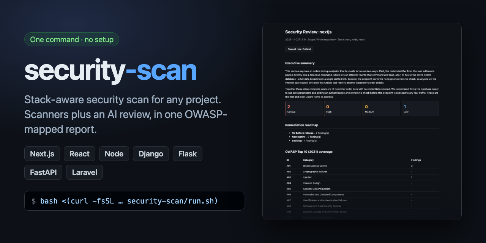
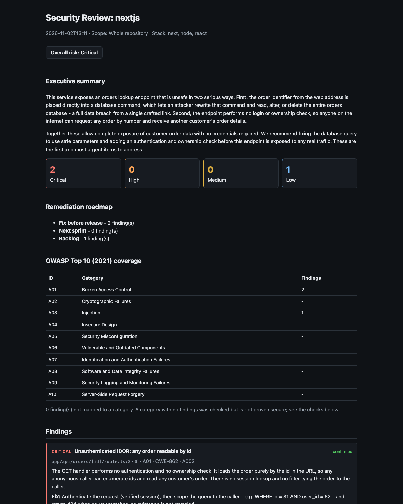

# security-scan



Stack-aware security review for any project, with zero per-project setup. Point it
at a repo and it detects the stack (Next.js, React, Node API, Django, Flask,
FastAPI, PHP/Laravel, React Native, Docker), runs the right scanners, adds an AI
review of what scanners cannot see, and writes an HTML report mapped to OWASP Top 10.

Built on the `secure-review` skill in [`skill/`](skill/secure-review/SKILL.md).

## Quick start

Run this from inside your project (a git repo with at least one commit):

```bash
bash <(curl -fsSL -H "Accept: application/vnd.github.raw" https://api.github.com/repos/pruthvidarji1993/security-scan/contents/run.sh)
```

Or pass a path: append `/path/to/project`.

The script clones this repo to `~/.cache/security-scan`, updates it on every run, and scans
the project. Nothing is added to, edited in, or committed to the scanned project. You do not
need to edit any config or have write access to this repo.

If `curl` fails (it prints an error but the command still exits 0), use git instead:

```bash
git clone https://github.com/pruthvidarji1993/security-scan.git ~/.cache/security-scan 2>/dev/null \
  || git -C ~/.cache/security-scan pull -q --ff-only
~/.cache/security-scan/run.sh /path/to/project
```

The one-liner uses the GitHub API (60 requests per hour per IP without a token). Behind a
shared office network, prefer the git version.

**Needs:** `python3` 3.10+ and `git`. Scanners install themselves on first use into
`~/.cache/secure-review`. The AI review needs the `claude` CLI, logged in; without it
you still get the scanner results.

**Flags** (after the path): `--no-open` do not open the report in the browser;
`--no-ai` scanners only, no Claude usage (findings are labelled `UNVERIFIED`).

**Output:** `reports/<date>/<project>/` inside the security-scan folder (for the
one-liner: `~/.cache/security-scan/reports/...`): `report.html` (client report),
`findings.txt` (developer list) and `reports/<date>/SUMMARY.md`. A single-project scan
opens `report.html` and prints its path; scheduled runs only show a notification.

## Before you scan

- **Install dependencies first** (`npm install`, `composer install`, `pod install`). Some
  checks need them: JS needs `node_modules`; PHP and iOS need `composer.lock` / `Podfile.lock`.
  The scanner never installs for you, because install scripts run arbitrary code. A missing
  prerequisite shows as `skipped` in the report's Checks table, so check it for `skipped` rows.
- **Log in to `claude`.** Without it the AI-only checks (access control, CSRF, injection and
  so on) are marked not checked and findings are `UNVERIFIED`.
- **Expect 2-10 minutes and about 100-220k tokens per repo** for the AI review.

## What it checks

| Layer | Covers |
|---|---|
| Scanners | semgrep (OWASP + per-stack rules), gitleaks (full git history), bandit, pip-audit, osv-scanner (Composer, CocoaPods), web-secure-verification (JS) |
| Supply chain | unpinned or git/URL dependencies, missing lockfile, install-time scripts in `node_modules`, pip `--extra-index-url` (dependency confusion) |
| AI review | per-stack checklists: access control, fail-open auth, rate limits, password hashing, CSRF, SSRF, uploads, deploy hygiene (exposed endpoints, source maps, default credentials, cookie flags) |

**Limits:** static analysis only, no runtime or DAST testing, so a clean report is not proof
of security. Vue and Angular are detected as generic Node and get a lighter AI review. Go and
Java are not reviewed by AI (semgrep and gitleaks only). Kotlin and native iOS are untested.

## What you get

The terminal shows the findings list, then the report opens in your browser:

```
=== nextjs ===
overall risk: Critical
[CRITICAL] app/api/orders/[id]/route.ts:2 - Unauthenticated IDOR: any order readable by id - ...
[CRITICAL] app/api/orders/[id]/route.ts:3 - SQL injection via order id - Use a parameterised query ...

report: ~/.cache/security-scan/reports/2026-11-02_1311/nextjs/report.html
```



The report is one self-contained HTML file (light and dark, prints to PDF, safe to email):
executive summary, counts by severity, remediation roadmap, OWASP Top 10 coverage, and each
finding with the exploit and the fix. [Download a sample](docs/sample-report.html).

## Scan many projects on a schedule

```bash
./setup.sh --schedule      # macOS: weekly, Mondays 09:00
```

Edit [`config.json`](config.json):

| key | meaning |
|---|---|
| `projects` | repos to always scan: an absolute path, or a folder name under a root |
| `roots` | folders searched for git repos (up to 3 levels deep). `[]` scans only `projects` |
| `exclude` | repo names or paths to skip (globs ok) |
| `max_repos_per_run` | cap per run; the rest roll over to the next run |
| `ai_review` | `false` = scanners only, no Claude usage |

New repos under `roots` are picked up automatically. Each run scans only repos whose
HEAD changed: a `diff` against the last scan, or a `full` scan for a new repo.
`python3 scan.py` with no argument does one run now. `python3 scan.py <path>` ignores
the config and always does a full scan of that path.

## Use it inside Claude Code

`./setup.sh` links the skill into `~/.claude/skills`, so `/secure-review [diff|full|deps]`
works in any project.

## Token use

Scanners run locally and cost no tokens. Only the AI review uses Claude, and it is kept lean:

- It runs only when there is source code to read; a repeat scan where only non-code files
  (README, lockfile) changed skips it and says so.
- Unchanged repos are not rescanned, and repeat scans review only what changed.
- It starts with just the tools it needs (no skill list, no MCP servers), about 8k tokens of
  fixed overhead instead of 36k. Each run prints the tokens and cost it used.
- `--no-ai` skips it entirely.

## Safety

- Scans local checkouts only. It never pulls, edits or commits to them.
- The AI review can read the repo and write only into its own report folder, and treats
  repo content as untrusted. If it fails, you still get scanner results.
- Secret values are never written to reports. `state.json`, `reports/` and `logs/` are
  gitignored.
- `run.sh` runs whatever is on `main` of this repo. Pin a tag if you need stable behavior.

## License

[MIT](LICENSE)

## Tests

```bash
python3 scan.py --selftest
python3 skill/secure-review/scripts/secure_review.py selftest
```
