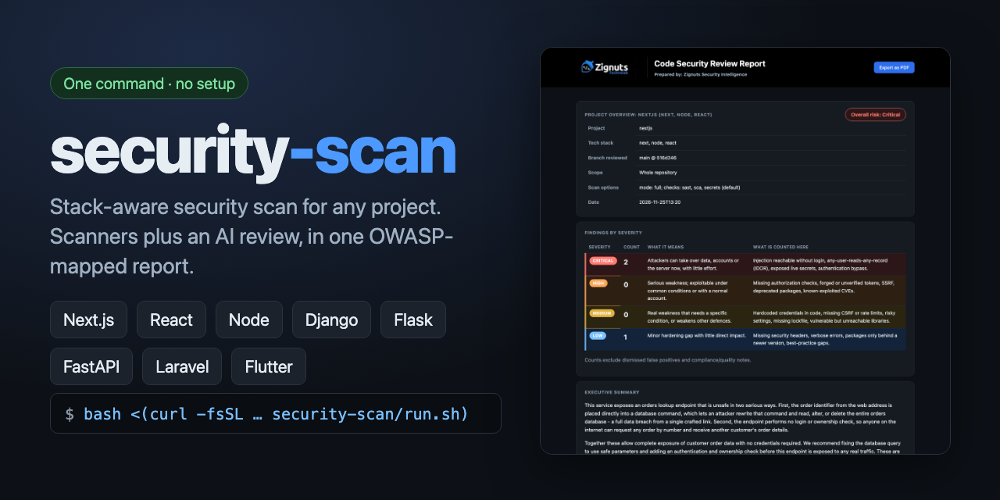
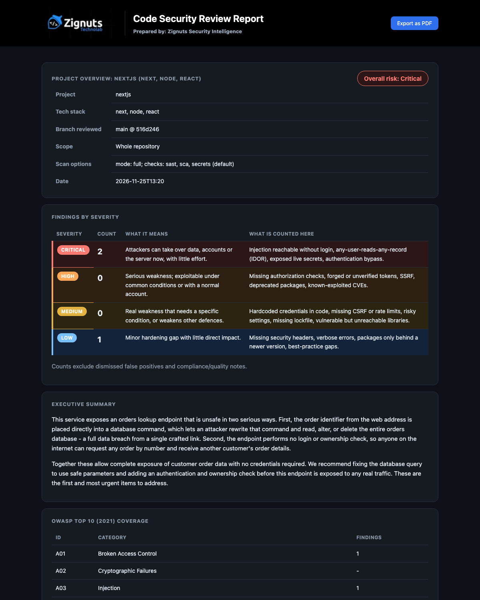

# security-scan



One command that checks your project for security problems and gives you a report you can read
or send to a client.

It works out what your project is built with (Next.js, React, Node API, Django, Flask, FastAPI,
PHP/Laravel, React Native, Docker), runs the right security tools, and then has Claude read your
code for the problems tools usually miss: users seeing other users' data, missing login checks,
forged tokens and similar flaws. You do not set anything up per project.

## Quick start

**1. You need:** `python3` 3.10+, `git`, and the `claude` CLI logged in. Without `claude` it
still runs, but only the automatic tools, not the code review.

**2. Install your project's dependencies** (`npm install`, `composer install`, `pod install`).
The scan never installs them for you, because install scripts can run any code.

**3. Run this from inside your project:**

```bash
bash <(curl -fsSL -H "Accept: application/vnd.github.raw" https://api.github.com/repos/pruthvidarji1993/security-scan/contents/run.sh)
```

To scan another folder, add its path at the end. Your project is never changed: nothing is
added, edited or committed.

When it finishes, the findings are printed in the terminal and the report opens in your browser.

## First scan and repeat scans

- **First scan:** checks the whole project. On a large project it can take a while (see
  [Time and cost](#time-and-cost)).
- **Next scans:** check only what changed since the last scan (new commits and uncommitted
  files). If nothing changed, it tells you so and prints where the last report is.
- If the code review failed or was skipped last time, those commits are checked again next time.
- **Once a month it does a full scan by itself** (if the code changed since the last full scan).
  A repeat scan only reads changed files, so it can miss a change that breaks something in a file
  you did not touch, for example a removed login check that an old page relied on. The monthly
  full scan catches that.

**No git history (e.g. a zip download)?** It still works. Instead of commits, it remembers a
fingerprint of every file, and the next scan checks only files that are new or changed. Unzip
each new version into the **same folder** (delete the old contents first): scan history is kept
per folder, so a different folder starts with a full scan.

All of this happens automatically, whether you run the command yourself or on a schedule. You
only need `--full` when you want a full check right now, for example before a client delivery.

## Options

Add these after the command (or after the path):

| Option | What it does |
|---|---|
| `--full` | Check the whole project again, not just what changed |
| `--no-ai` | Only the automatic tools, no Claude review (free, but less thorough) |
| `--no-open` | Do not open the report in the browser |

## Reading the report

- **Overall risk** is the worst confirmed problem: Critical, High, Moderate, Low, or
  No confirmed issues.
- Each finding says where it is (`file:line`), how someone could exploit it, and how to fix it.
- **Confirmed**: Claude checked it and it is real. **Suspicion**: looks wrong but could not be
  proven. **Unverified**: found by a tool, not checked by Claude (for example with `--no-ai`).
- **Checks table:** each tool has a one-line description of what it does. Look for `skipped` rows. Each one says what was not checked and why
  (usually a missing dependency or lockfile).
- **Scope** says how much code Claude read, e.g. "read 120 of 150 source files". Files it did
  not reach are listed and are read first on the next scan.

The report is a single HTML file (light and dark mode, prints to PDF, safe to email).
[Download a sample](docs/sample-report.html).



Where reports are saved: `~/.cache/security-scan/reports/<date>/<project>/report.html`, next to
`findings.txt` (a plain list for developers).

## Time and cost

The automatic tools are free. Only the Claude review costs tokens.

- Claude reads your code in rounds of 40 files, up to 5 rounds per scan, **3 rounds at the same
  time**. In my test, the same project took 7 minutes instead of 16.
- Each round takes 2-10 minutes and costs about $0.30-0.50. Running rounds at the same time
  does not change the total cost.
- A first scan of a large project can cost about $1.50-2.50. Repeat scans usually take one round.
- If only non-code files changed (README, lockfile), Claude is not used at all.
- The cost of each scan is printed at the end. Use `--no-ai` to spend nothing.

## What it checks

| Part | What it looks for |
|---|---|
| Automatic tools | Known dangerous code patterns, passwords and keys committed to git (including old commits), libraries with known vulnerabilities |
| Dependencies | Packages with no version, packages installed from a URL, a missing lockfile, packages that run scripts when installed. A version range such as `>=2.0` is fine. Deprecated packages are High; just being behind a newer version is Low |
| Claude code review | Users reaching other users' data, admin pages without login checks, tokens that are not verified, injection (SQL, shell commands, file paths), weak password storage, missing rate limits, unsafe uploads, risky deploy settings |

Even without `node_modules` (for example on a fresh clone), vulnerable npm libraries are still
found from `package-lock.json`, `yarn.lock` or `pnpm-lock.yaml`. Some JavaScript checks need
`node_modules`, so install for the full picture.

## Troubleshooting

| Problem | Fix |
|---|---|
| The `curl` command prints an error | Use git instead (also better on a shared office network, where GitHub limits requests): see below |
| "nothing was scanned: unchanged since last scan" | Nothing changed since the last scan. Add `--full` to scan again anyway |
| "git repo has no commits yet" | Make a first commit, or delete the empty `.git` folder to scan it as a plain folder |
| "folder not found or empty" | Check the path you passed |
| "a scan is already running" | Wait for the other scan to finish, or stop it with `pkill -f security-scan/scan.py` |
| `skipped` rows in the report | Install dependencies or commit the lockfile it names, then scan again |

Git version of the quick start:

```bash
git clone https://github.com/pruthvidarji1993/security-scan.git ~/.cache/security-scan 2>/dev/null \
  || git -C ~/.cache/security-scan pull -q --ff-only
~/.cache/security-scan/run.sh /path/to/project
```

## Scan many projects on a schedule

```bash
./setup.sh --schedule      # macOS: every Monday at 09:00
```

Then edit [`config.json`](config.json):

| Setting | Meaning |
|---|---|
| `projects` | Projects to always scan: a full path, or a folder name inside a root |
| `roots` | Folders to search for projects (up to 3 levels deep). `[]` = only `projects` |
| `exclude` | Project names or paths to skip (wildcards allowed) |
| `max_repos_per_run` | Most projects per run; the rest wait for the next run |
| `ai_review` | `false` = no Claude review, automatic tools only |
| `review_batch_files` | Files Claude reads per round (default 40) |
| `review_max_passes` | Most rounds per project per run. Default `0` = no limit, every source file is read. Set a number to cap cost; files left over are read first on the next scan |
| `review_parallel` | Rounds run at the same time (default 3). Set `1` if you hit Claude usage limits |
| `full_scan_every_days` | Do a full scan when the last one is this old (default 30). `0` = never |

New projects under `roots` are found automatically, and only projects with new commits are
scanned. `python3 scan.py` runs once now.

**Questions before a scan (in a terminal):**
1. **Scan types** (pick any): SAST (semgrep, bandit), SCA (pip-audit, npm audit, osv-scanner, supply-chain), Secret Scanning (gitleaks), AI code review. Enter = the three scanners, no AI, no tokens.
2. **AI focus** (only if AI review was picked): Authentication, Authorization, Data security, Endpoint, Confidentiality, Key management. Enter = all.
3. **Model** (only if AI review was picked): machine default, sonnet, opus or haiku.

Skip the questions with flags: `--types sast,sca,secrets,ai`, `--focus authn,authz,data,endpoint,confidentiality,keys`, `--model sonnet`
(`--no-ai` still works). Scheduled or piped runs never ask: they run all four types, all areas, machine default model.
A run limited to some types or focus areas does not save scan history, so the next full-type scan still starts from the last complete one.

## Use it inside Claude Code

`./setup.sh` adds the skill to Claude Code, so you can type `/secure-review` in any project.
Options: `diff` (only your changes, the default), `full` (whole project), `deps` (libraries only).

## Safety

- It only reads your project. It never edits, commits or pulls.
- Claude can only write into its own report folder, and ignores any instructions found inside
  your code.
- Passwords and keys it finds are never written into the report. Keys and passwords inside test
  folders (`tests/`, `__tests__/`, `fixtures/`, `*.test.js` and similar) are ignored.
- `run.sh` always uses the latest version on `main`. Pin a release tag if you need it to stay
  the same.

## For maintainers

```bash
python3 scan.py --selftest
python3 skill/secure-review/scripts/secure_review.py selftest
```

Built on the `secure-review` skill in [`skill/`](skill/secure-review/SKILL.md). Scan history is
kept in `state.json` (one entry per project folder, so a fresh clone in another folder starts
with a full scan).

## License

[MIT](LICENSE)
